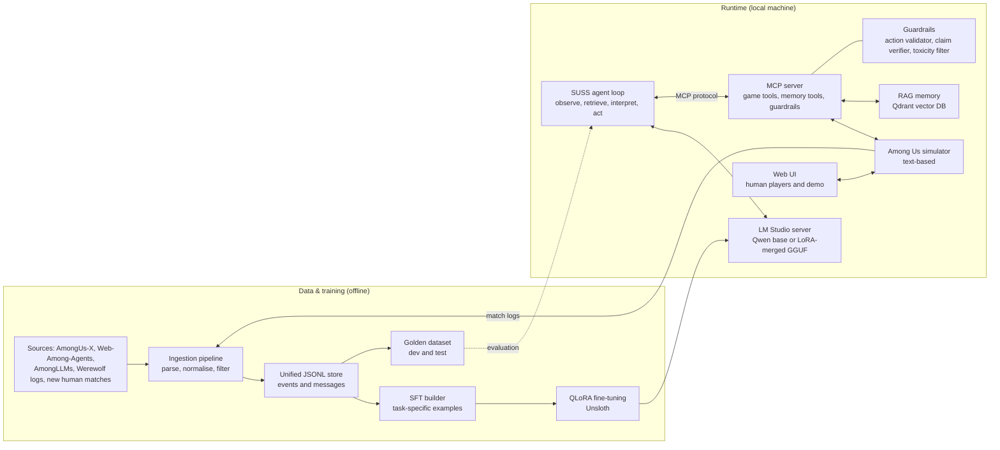
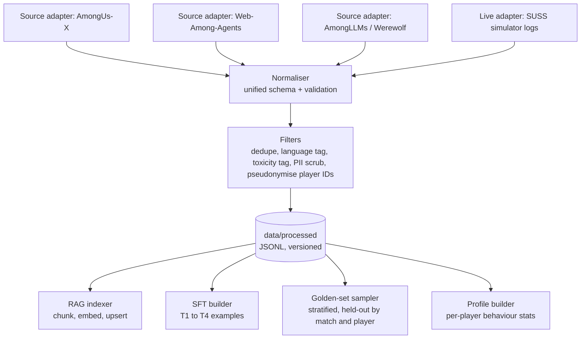
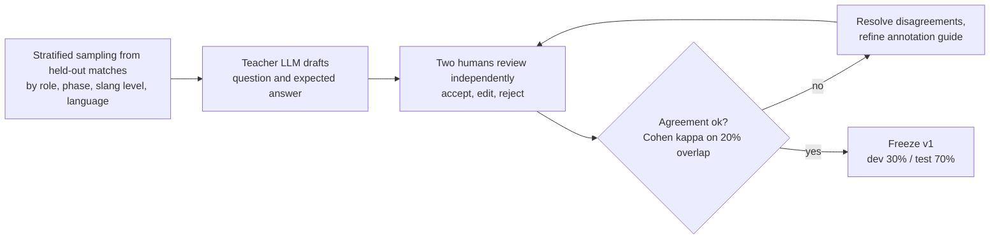
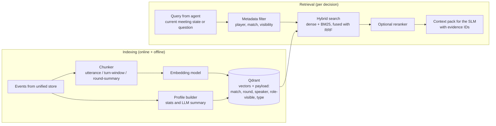
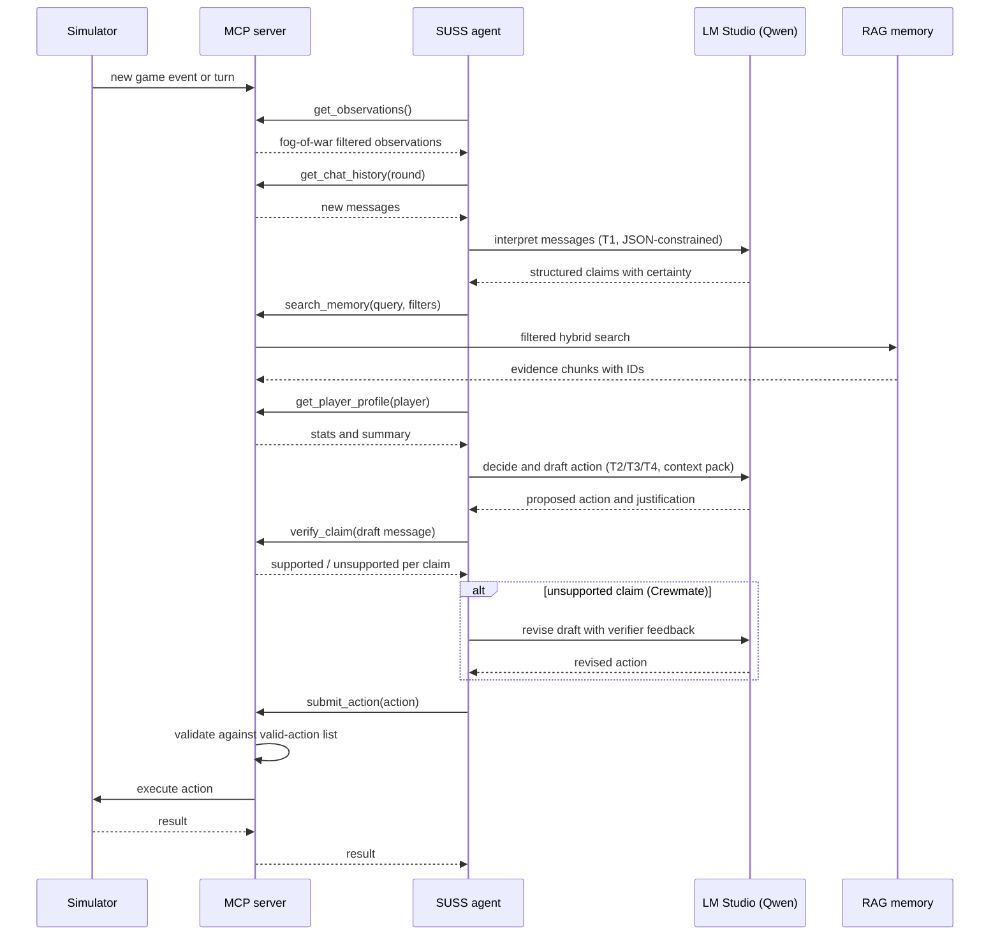

# SUSS — Milestone 2: Architecture & Project Plan

**Project:** SUSS (Social Understanding & Suspicion System) — a locally hosted, fine-tuned small language model (SLM) agent that plays an Among Us-style social-deduction game and adapts to human players.
**Course:** UDLLM · **Milestone:** 2 (architecture + plan) · **Builds on:** Week 4 RFC (`docs/RFC`)

> **Reading guide.** Sections 1–6 map one-to-one to the points requested in the milestone brief. Section 7 contains risks, and Section 8 the repository layout. 

---

## 0. Summary of the design

SUSS is a four-layer system:

1. **Game layer** — an existing text-based Among Us simulator that supports both AI and human players, wrapped by a thin adapter so we do not depend on one specific codebase.
2. **Tool layer** — an **MCP server** that is the *only* way the agent can observe the game, query memory, and act. It enforces fog-of-war (the agent sees only what its character could see) and validates every action.
3. **Memory layer** — a **RAG** subsystem holding (a) in-match events, (b) discussion utterances, and (c) cross-match **player profiles**.
4. **Model layer** — a **Qwen-family SLM**, QLoRA fine-tuned, served locally through LM Studio.

The research question (from the RFC) is tested by an **ablation ladder**: Base → Fine-tuned → Fine-tuned + RAG → Full SUSS (with player profiles), always with the same simulator, seeds and held-out human players.



---

## 1. Problem and data

### 1.1 The task

An Among Us-style game is a sequence of **free-roam phases** (move, do tasks, observe, kill/sabotage if Impostor) and **meeting phases** (discuss, accuse, defend, vote). SUSS must make decisions in both, as either role, using only the information its character legitimately has.

The decisions are grouped into **four learnable tasks**, which also define our fine-tuning and evaluation targets:

| ID | Task | Input | Output |
|----|------|-------|--------|
| T1 | **Message interpretation** | One chat message + short context | Structured JSON: accused player, claimed location/time, certainty (`confirmed / uncertain / retracted / joke`), speech act (`accusation / defence / info / question / banter`) |
| T2 | **Meeting decision** | Observation log, interpreted claims, retrieved memories | Who to accuse / defend / vote for (or skip), with a short justification that cites evidence IDs |
| T3 | **Utterance generation** | Role, strategy, evidence | A short in-character chat message (Crewmate: truthful; Impostor: deceptive but consistent with its own prior statements) |
| T4 | **Free-roam action selection** | Local game state, valid-action list | One valid action (move / task / kill / report / sabotage) |

The thing we want to study is the *human* side of T1–T3: informal, uncertain, self-correcting language such as
`"bro I swear red was in elec 💀 wait maybe pink idk"` → `{accused: red→pink, location: electrical, certainty: uncertain, retracted: red}` and not "red is confirmed in electrical".

### 1.2 Datasets

| Dataset | What it gives us | Role in SUSS | Known limitation |
|---|---|---|---|
| **AmongUs-X** | ~8.7k simulated games with discussions, decisions, beliefs and outcomes | Main source for T2/T4 SFT and for the RAG corpus | AI-vs-AI language is cleaner than human language |
| **Web-Among-Agents** | ~411 human–AI games | Human-language adaptation (T1/T3), **held-out evaluation** | Small; no ready-made labels for communication style |
| **AmongLLMs** | Simulated games, transcripts and simulator code | Additional trajectories; reference for simulator and prompts | Format/licence to confirm |
| **Werewolf Among Us** | Human social-deduction dialogue | Supplementary informal-language examples for T1/T3 | Different game; used only for language, not for game decisions |
| **New SUSS matches** (our own) | Human matches in our simulator, with consent | Held-out test set + repeated-match adaptation experiments | Small; costs team time |

 The validation checklist is: (1) schema and fields actually present, (2) whether stable per-player identifiers exist across games (needed for profiles), (3) licence and redistribution terms, (4) share of human vs AI messages, (5) language/slang/typo density, (6) ground-truth roles available. Outcomes decide the **fallback**: if cross-match player IDs are missing in the public data, player profiling is trained/tested only on our own repeated matches and on *synthetic personas* (see 1.4).

### 1.3 Ingestion architecture (supporting new data)

New data must be addable without touching the model code. Every source gets one small **adapter** that converts it to a single internal schema; everything downstream (indexing, SFT building, golden-set sampling, evaluation) reads only that schema.



**Unified event schema** (one JSON object per line):

```json
{
  "match_id": "m_000123",
  "source": "web-among-agents",
  "round": 2,
  "phase": "meeting",
  "t": 14,
  "speaker": "p_7f3a",
  "speaker_kind": "human",
  "role_hidden": "crewmate",
  "type": "message",
  "text": "bro I swear red was in elec 💀 wait maybe pink idk",
  "visible_to": "all",
  "lang": "en",
  "flags": {"toxic": false, "pii": false}
}
```

Other `type` values: `move`, `task`, `kill`, `body_found`, `vote`, `ejection`, `match_end`. `role_hidden` is **never** exposed to the agent at runtime; it exists only for training labels and evaluation.

**Ingesting new data** = (1) put raw files in `data/raw/<source>/`, (2) write or reuse an adapter (`ingest/adapters/*.py`, ~50 lines, must pass the schema validator), (3) run `make ingest`. Live human matches in our simulator are written to the same schema automatically, so every playtest immediately becomes new RAG memory, training candidate and, if marked held-out, evaluation material.

**Data hygiene rules.** Player identifiers are pseudonymised; human participants give written consent; the toxicity tagger marks (not deletes) abusive messages so we can use them for the toxicity-handling evaluation but exclude them from SFT; **splits are by match and by player**, never by message, to avoid leakage.

### 1.4 Handling the lack of labelled human data

Public data does not contain our T1 labels. We create them in three tiers, tracked in the data card:

- **Gold** (human-verified, small, ~300 items): the golden dataset (Section 2).
- **Silver** (teacher-LLM-labelled, spot-checked): a larger model labels messages with the T1 schema; we manually audit a random sample (≥10%) and report agreement. Only silver labels with a passing audit enter SFT.
- **Synthetic augmentation**: take clean AI-generated messages and rewrite them into informal human style (slang, typos, emoji, hedges, code-switching), keeping the label intact because only the surface form changes. Also generate **synthetic player personas** (aggressive accuser, silent player, serial skipper, confusing speaker) to test profiling before enough human matches exist.

---

## 2. Golden dataset

**Purpose:** a fixed, reviewed benchmark with questions and expected answers that every system variant is scored against. It is *never* used for training or prompt tuning, beyond the dev split.

### 2.1 Composition (target ≈ 300 items)

| Category | Items | Question → expected answer | Source of ground truth |
|---|---|---|---|
| **A. Message interpretation** (T1) | ~120 | Messy human message → structured claim JSON | Human annotators |
| **B. Meeting decisions** (T2) | ~80 | Reconstructed meeting state → best vote / accusation; scored as correct if the vote hits the real Impostor (as Crewmate) or a *safe* target (as Impostor) | Simulator ground truth (real roles) |
| **C. Memory & profile retrieval** | ~60 | "What did player X claim in round 2?", "Has player Y skipped votes before?" → expected evidence chunks / answer | Logs (automatic) + human check |
| **D. Safety / hallucination traps** | ~40 | Situations where the evidence does **not** support an accusation, or a message is abusive → expected: no unsupported accusation / appropriate refusal-or-neutralisation | Human annotators |

### 2.2 Construction pipeline



Key rules:

- **Ground truth never comes from the model being evaluated.** Category B/C answers come from simulator logs; A/D from humans. The teacher LLM only *drafts*; humans decide.
- **Held-out by match and by player.** No match or player in the golden test split appears in training or in the RAG corpus used at test time (except in the deliberate "repeated-match" experiment, which uses a separate protocol, Section 6).
- **Stratified** so rare-but-important cases (retractions, jokes, sarcasm, mixed language, typos) are not drowned out by easy cases.
- **Versioned** (`eval/golden/v1/`), with a data card and a changelog. We build `v0` (~50 items) in Week 7 so evaluation is possible early, and `v1` (~300) in Week 8.

### 2.3 Item format

```json
{
  "id": "A-0042",
  "category": "message_interpretation",
  "input": {
    "context": ["Cyan: where was everyone?"],
    "message": "bro I swear red was in elec 💀 wait maybe pink idk"
  },
  "expected": {
    "speech_act": "accusation",
    "accused": ["pink"],
    "retracted": ["red"],
    "location": "electrical",
    "certainty": "uncertain"
  },
  "tags": ["slang", "emoji", "self-correction"],
  "split": "test"
}
```

### 2.4 Scoring

- **A:** field-level F1 on the structured output; exact-match on `certainty`; JSON-validity rate.
- **B:** vote accuracy (Crewmate: vote on real Impostor), plus agreement with an "oracle-with-hindsight" reference.
- **C:** Recall@k and MRR of the retrieved evidence; answer correctness.
- **D:** unsupported-accusation rate; toxicity-handling accuracy.
- Always reported with **bootstrap 95% confidence intervals** and over ≥3 seeds for stochastic components.

---

## 3. RAG design

### 3.1 What is stored

| Memory store | Content | Scope | Used for |
|---|---|---|---|
| **Episodic (in-match)** | Observations, movements, bodies found, votes | Current match | Verifying claims, building alibis |
| **Conversation memory** | Chat utterances with metadata | Current + past matches | "Who said what", contradictions |
| **Player profile memory** | Behavioural statistics + short text summary per pseudonymised player | Cross-match | Personalised decisions — **the core contribution** |



### 3.2 Chunking strategy (and what we will compare)

Game text is short, conversational and *speaker-attributed*, so generic fixed-size chunking tends to cut across speakers and lose who-said-what. Our primary choice is **structure-aware chunking**:

- **Atomic chunk** = one utterance or one game event, prefixed with `[round, speaker, phase]` and carrying the same fields as payload metadata.
- **Window chunk** = a sliding window of ~3–5 consecutive utterances within one meeting, so replies keep their context (e.g. "no it wasn't me" needs the previous accusation).
- **Summary chunk** = a per-round or per-match summary (generated by the SLM, checked against logs) for cheap long-range recall.

**Experiment E3 compares:** (a) fixed-size 256 tokens with 20% overlap [baseline], (b) utterance-level, (c) utterance + window, (d) utterance + window + summary (hierarchical). Chosen by Recall@k / MRR on category-C golden items, then confirmed on downstream gameplay.

### 3.3 Embedding model (and what we will compare)

Requirements: runs locally and cheaply, handles informal English and **possibly mixed languages**, short texts, and fits alongside the SLM on a 16 GB-class GPU (or CPU).

| Candidate | Why |
|---|---|
| **Qwen3-Embedding-0.6B** *(current primary)* | Same family as our generator, multilingual, small, runs locally |
| **BGE-M3** | Strong multilingual, supports dense + sparse in one model; a strong alternative |
| **all-MiniLM-L6-v2** | Tiny, fast, widely used — serves as the *lightweight baseline* |

**Experiment E4** picks the best on category-C golden items with latency and memory as secondary criteria. 

### 3.4 Vector database

**Choice: Qdrant (local/Docker).** Reasons: (1) **payload filtering is first-class**, and almost every query of ours is filtered (by player, match, visibility) — this is what makes player-specific memory and fog-of-war enforceable; (2) supports hybrid dense+sparse search; (3) runs fully locally with no cloud dependency; (4) simple Python client.
*Alternatives considered:* **Chroma** (simplest, but weaker filtering/hybrid story), **FAISS** (fast, but no metadata/persistence layer — we would rebuild what Qdrant gives). **Fallback:** Chroma, if Qdrant setup costs too much time; the retrieval interface is abstracted, so swapping is a one-file change.

### 3.5 Retrieval approaches we will compare (Experiment E5)

| ID | Approach | Hypothesis |
|---|---|---|
| R0 | **No retrieval** | Baseline |
| R1 | Naive dense top-k | Helps, but retrieves irrelevant players' messages |
| R2 | **Metadata-filtered dense** (by player/match/visibility) | Large gain for "what did X say" queries |
| R3 | **Hybrid** (dense + BM25 via reciprocal-rank fusion) | Better on slang, nicknames and room names that embeddings blur |
| R4 | R3 + **cross-encoder reranker** (e.g. bge-reranker) | Small further gain; check whether latency is worth it |
| R5 | **Structured profile injection** (stats + summary, no vector search) vs R2/R3 raw-evidence retrieval | Tests *how* to personalise: compact summaries vs retrieved raw evidence |

Metrics: Recall@k, MRR, context length used, and downstream gameplay metrics (Section 6). The **best of R0–R4** is combined with R5 in the full SUSS configuration.

### 3.6 Player-profile memory (the differentiator)

After each match, the profile builder updates, for each pseudonymised player, a small set of **verifiable statistics** computed from logs (not by the LLM): accusation rate, speaking rate, skip-vote rate, how often their accusations turned out correct, how often they changed claims, a "confusing language" proxy (typo/slang density). A short natural-language summary is generated from these numbers and stored with the stats. Because the numbers come from logs, the profile cannot "hallucinate" a behaviour. At decision time, the agent retrieves the profile of each relevant player and the prompt includes it as evidence, e.g. *"p_7f3a: accuses often (0.6/meeting) but was right 1/5 times → treat accusations with caution."*

**Ablation:** same model, same RAG, same seeds, profiles **on vs off** — isolating the personalisation effect, as required by our research question.

---

## 4. Agent and tools

### 4.1 Decisions the agent makes

| Phase | Crewmate | Impostor |
|---|---|---|
| Free roam | Choose destination, choose/complete task, report a body, share what it saw | Choose destination, choose kill target and timing, build an alibi (fake tasks), sabotage |
| Meeting | Interpret others' messages (T1), form suspicion ranking, speak (T3), defend itself | Interpret messages, deflect suspicion, make a plausible lie *consistent with its earlier statements*, steer votes |
| Vote | Vote on most-supported suspect or skip | Vote to avoid suspicion while protecting itself/partner |

### 4.2 Agent loop

The agent is a **deterministic orchestrator around the SLM**, not a free-running autonomous loop: the model proposes, the tools verify. This keeps a small model reliable.



### 4.3 MCP server — tool surface

The MCP server (Python, official MCP SDK / FastMCP) exposes tools, resources and prompts. The design principle: **the agent has no direct access to the simulator or database; MCP is the single, auditable boundary.** It runs over stdio for local development and Streamable HTTP when the simulator and agent run as separate processes.

| Tool | Type | What it does |
|---|---|---|
| `get_game_state()` | read | Public state: phase, round, alive players, tasks bar |
| `get_observations(since)` | read | Only what *this* player legally perceived (location, who it saw, bodies) |
| `get_chat_history(round, limit)` | read | Meeting messages visible to the agent |
| `list_valid_actions()` | read | Exact set of currently legal actions |
| `search_memory(query, player?, match?, k, mode)` | read | Filtered RAG search; `mode` ∈ {dense, hybrid, rerank} |
| `get_player_profile(player)` | read | Stats + summary for a pseudonymised player |
| `verify_claim(claim)` | read | Checks a statement against the agent's own observations → `supported / contradicted / unknown` + evidence IDs |
| `check_toxicity(text)` | read | Toxicity score for incoming/outgoing text |
| `send_message(text)` | write | Post to meeting chat (runs `verify_claim` + toxicity filter first) |
| `submit_action(action)` | write | Move / task / kill / report / sabotage / vote — rejected if not in `list_valid_actions()` |
| `update_player_profile(match_id)` | write | Post-match: recompute profile stats from logs |

**Resources:** `suss://rules`, `suss://map`, `suss://player/{id}/profile`. **Prompts:** role-specific system prompts (`crewmate_meeting`, `impostor_meeting`, `free_roam`) stored on the server so prompt versions are tracked with the code.

### 4.4 Guardrails (hallucination and toxicity handling)

- **Action constraint:** `submit_action` rejects anything outside `list_valid_actions()`; constrained/JSON-schema decoding for the action format; max 2 retries, then a safe default (e.g. skip/wait). → measures **valid-action rate**.
- **Hallucination handling:** every factual claim in a Crewmate's draft is checked by `verify_claim` against its own observations; unsupported claims are removed or revised. (An Impostor may lie *by design*, so for the Impostor the verifier instead enforces **self-consistency** with its own prior statements.) → measures **unsupported-accusation rate**.
- **Toxicity handling:** a lightweight classifier (e.g. Detoxify or a small LM-based classifier) screens incoming messages (flagged and down-weighted as evidence, so abuse is not treated as testimony) and outgoing messages (blocked or rewritten). → measured on golden category D.
- **Fog-of-war:** MCP never returns hidden roles or information the character could not see; the golden-set and logs use hidden roles, the agent never does.

---

## 5. Model choices

### 5.1 Generator (the SLM)

| Candidate | Size | Role | Notes |
|---|---|---|---|
| **Qwen3-4B (Instruct)** *(current primary)* | ~4B | Main fine-tuning target | Fits QLoRA comfortably, quick inference, good instruction/JSON following for its size |
| **Qwen3-8B (Instruct)** | ~8B | Stretch / upper reference | Likely better reasoning, tighter on memory and slower in play; trained only if 4B results justify |
| **Qwen3-1.7B** | ~1.7B | Lower bound | Shows how small we can go |

**Why Qwen:** strong open-weight family at small sizes, permissive licence, multilingual (useful for mixed-language messages), excellent tooling support (Unsloth, GGUF, LM Studio), and the same family also provides our embedding/reranker options.

**Why QLoRA, not full fine-tuning:** our hardware (Ryzen 9 9900X, RTX 5060 Ti, 32 GB RAM) is sized for LoRA/QLoRA on 4B–8B models. 

**Selection procedure (Week 7):** run the *untuned* candidates on the golden dev set and in the simulator through LM Studio; pick the model with the best quality/latency trade-off. Thinking-mode will be disabled during play to keep turn latency low, and compared on dev only.

### 5.2 Other models

| Role | Choice | Why |
|---|---|---|
| **Teacher / labeller** (offline only, optional) | A larger open model (Qwen3 14B–32B, quantised, local) or an API model | Drafting silver labels, synthetic informal rewrites, golden-item drafts; never a judge of its own output without human audit |
| **Embeddings / reranker** | Section 3.3 / 3.5 | |
| **Toxicity classifier** | Detoxify or a small classifier | Cheap, runs on CPU |
| **LLM-as-judge** (secondary) | Larger model, with a fixed rubric, calibrated against human ratings on a sample | Only for open-ended quality (e.g. utterance plausibility); primary metrics remain objective |

### 5.3 Fine-tuning recipe

- **Method:** QLoRA (4-bit base, LoRA adapters on attention + MLP), via Unsloth; adapters are merged and exported to GGUF for LM Studio.
- **Mixture:** T1 (interpretation, incl. silver + augmented informal data), T2 (decisions from AmongUs-X, outcome-filtered: prefer trajectories of winning/correct players), T3 (utterances), T4 (actions); task-prefixed, JSON-structured outputs.
- **Runs:** FT-1 (T1+T2+T4 on AI data) → FT-2 (add informal/human-style data and T3). A *no-informal-data* ablation (FT-1 vs FT-2) tests whether informal-language training helps human understanding.
- **Hygiene:** split by match/player; golden-set items excluded; the training-data hash and config are committed with each run.
- **Optional extension:** distillation from the teacher model if time allows.

---

## 6. Evaluation design & experiments

### 6.1 Systems compared

| System | Fine-tuned | RAG | Player profiles | MCP tools & guardrails |
|---|:-:|:-:|:-:|:-:|
| S0 Base Qwen | – | – | – | basic (valid actions only) |
| S1 Fine-tuned Qwen | ✓ | – | – | ✓ |
| S2 Fine-tuned + RAG | ✓ | ✓ | – | ✓ |
| S3 Full SUSS | ✓ | ✓ | ✓ | ✓ |
| S3-ablation (no profiles) = S2 | ✓ | ✓ | – | ✓ |

### 6.2 Metrics

| Group | Metric |
|---|---|
| Language understanding | T1 field-F1, certainty accuracy, JSON validity (golden A) |
| Decision quality | Vote accuracy, oracle agreement (golden B) |
| Reliability | Valid-action rate, unsupported-accusation rate, toxicity-handling accuracy (golden D) |
| Memory | Recall@k, MRR (golden C) |
| Game outcome | Crewmate and Impostor win rate over N matches per role, with bootstrap CIs |
| **Adaptation** | Performance as a function of match index *k* against the *same* unfamiliar player (does it improve by match 3, 5?), and accuracy of predicting that player's next behaviour (accuse / skip / silent) |
| Efficiency | Latency per turn, VRAM |

### 6.3 Experiment list

| ID | Experiment | Compares | Primary metric | Planned in |
|---|---|---|---|---|
| E0 | Simulator + untuned model sanity | — | valid-action rate | W7 |
| E1 | **Baselines** (S0; candidate SLM sizes) | Qwen3 1.7B/4B/8B | golden A/B, valid-action rate | W7–8 |
| E2 | **Fine-tuning effect** | S0 vs S1; FT-1 vs FT-2 (informal data) | golden A (esp. slang/typo slice), win rate | W9 |
| E3 | Chunking | 4 strategies | Recall@k, MRR | W9 |
| E4 | Embedding models | 3 models | Recall@k, latency | W9 |
| E5 | Retrieval approaches | R0–R5 | Recall/MRR, downstream win rate | W10 |
| E6 | **RAG effect in gameplay** | S1 vs S2 | vote accuracy, win rate | W10 |
| E7 | **Personalisation effect** | S2 vs S3 (profiles off/on, all else fixed) | adaptation curve, vote accuracy | W11–W13 |
| E8 | **Human study** | S0–S3 vs held-out human players, repeated matches | all of the above | W13 |
| E9 | Guardrail ablation | with vs without verifier / toxicity filter | unsupported-accusation rate | W13 |

### 6.4 Controls against invalid conclusions

Fixed seeds and map configs across systems; held-out humans/matches; same prompts except for the component under test; ≥3 seeds and CIs, with an explicit note where sample sizes (especially human matches) are too small for significance; **negative results are reported as such** — the contribution is the controlled comparison, not a guaranteed win.

---

## 7. Plan — week by week to the Week 14 final presentation

> **Commitment note.** The brief states this timeline is our commitment and that the Week-12 review uses the GitHub commit history. We therefore (1) commit small and often with descriptive messages referencing the experiment/task ID; (2) keep `docs/PROGRESS.md` updated weekly; (3) tag the repository at the end of each week (`w7`, `w8`, …); (4) use issues/milestones that mirror this table. We deliberately plan **working, end-to-end baseline functionality before Week 12**, and keep Weeks 13–14 for human evaluation and writing, with Week 14 buffer.

| Week | Goals & deliverables (committed to GitHub) | Experiments |
|---|---|---|
| **6** *(now; M2 deadline)* | Upload this document to `docs/`. **Dataset validation:** download and inspect AmongUs-X and Web-Among-Agents; schema/licence/ID-availability report (`docs/data_report.md`). Repo skeleton, environment (`pyproject`, `Makefile`), CI lint. Simulator shortlist (AmongUs-X env, Web-Among-Agents, AmongLLMs) with a decision. | — |
| **7** | **Simulator running locally** with AI players; thin adapter + event logging to unified schema. **Ingestion v1** (first 2 adapters + schema validator). **LM Studio set up**; run untuned Qwen3 1.7B/4B/8B through it. **Golden v0** (~50 items). Pick base model. | E0, E1 (first numbers) |
| **8** | **Golden v1** (~300 items, dev/test split, annotation guide, agreement check). Remaining adapters (AmongLLMs, Werewolf) + filters (dedupe, PII, toxicity tag, pseudonymise). **SFT builder** for T1–T4; teacher-assisted silver labels + informal-style augmentation with audit sample. Baseline results table committed. | E1 complete |
| **9** | **Fine-tuning FT-1 and FT-2** (QLoRA, Unsloth) → merged GGUF → LM Studio. **RAG v1:** chunkers, embeddings, Qdrant indexing from the unified store. | E2, E3, E4 |
| **10** | **MCP server v1** (all read/write tools, valid-action enforcement, `verify_claim`, toxicity check) and **agent loop** wired to simulator. Retrieval comparison; best retrieval config chosen. | E5, E6 |
| **11** | **Player-profile builder + memory update** (post-match). Full SUSS (S3) running end-to-end. **Web UI** for human play and demo; consent flow + match logging. Begin human playtests (team + volunteers) — first data. Synthetic-persona tests for profiling. | E7 (synthetic personas, first pass) |
| **12** | **Milestone review (GitHub history).** Deliverable: working end-to-end S0–S3 in the simulator, committed results for E0–E6, reproducible scripts + README, architecture doc updated to *as-built*. Recruit held-out human players for Week 13. | Freeze E1–E6 results |
| **13** | **Human evaluation:** held-out players play repeated matches against S0–S3; adaptation curves; guardrail ablation; toxicity evaluation; error analysis and failure taxonomy. | E7 (humans), E8, E9 |
| **14** | **Final presentation.** Final results tables/plots, final report in `docs/`, demo video/live demo, code freeze + tag `v1.0`, limitations and future work. *Buffer for overruns.* | Reruns only |

**Scope control.** Core path (must-have): simulator, ingestion, golden set, fine-tuned model, RAG, MCP server, profile-vs-no-profile comparison, ≥ some human matches. **Stretch** (only if ahead of schedule): Qwen3-8B fine-tuning, distillation, mixed-language evaluation slice, reranker (R4), web UI polish.

---

## 8. Risks and mitigations

| Risk | Likelihood | Impact | Mitigation |
|---|---|---|---|
| Public datasets lack stable player IDs / labels for profiling | Medium | High | Profile experiments rely on our own repeated matches + synthetic personas; report honestly |
| Chosen simulator does not support human participation or is hard to run | Medium | High | Shortlist of three; decision in Week 6–7; Web-Among-Agents as human-capable fallback; worst case, a minimal own text-based game loop |
| Too few human matches for significance | High | Medium | Start collecting in Week 11; use repeated-match design; report CIs and limitations; add scripted "human-like" bots as supplementary opponents |
| GPU memory or training time limits | Medium | Medium | 4B model, short sequences, gradient accumulation; 1.7B fallback; training runs scheduled early (Week 9) with a re-run window |
| Small model produces invalid or hallucinated actions | High | Medium | JSON-schema constrained output, `submit_action` validation, `verify_claim`, safe defaults |
| Fine-tuning shows no benefit | Medium | Medium | Still a valid, reportable result; error analysis; prompt-only + RAG baseline is already in the ladder |
| Licence/ethics (human data, toxicity) | Low | High | Consent forms, pseudonymisation, no raw personal data in the repo, licence check in Week 6 |
| Team time shortage near exams/holidays | Medium | High | Core vs stretch split; Week 12 checkpoint; Week 14 buffer |

---

## 9. Proposed repository layout

```
suss/
├── docs/                  # RFC, this document, data_report.md, PROGRESS.md, final report
├── data/                  # raw/ (not committed), processed/ (schema, small samples), data cards
├── ingest/                # adapters/, normaliser, filters, schema validator
├── training/              # sft_builder/, qlora configs, export to GGUF
├── rag/                   # chunkers, embeddings, qdrant client, retrieval modes, profile builder
├── mcp_server/            # tools, resources, prompts, guardrails
├── agent/                 # orchestrator loop, prompts, constrained-decoding schemas
├── sim/                   # simulator adapter and game logging
├── eval/                  # golden/ (versioned), scoring scripts, experiment configs, results/
├── ui/                    # web application for human play and demo
└── Makefile               # make ingest | index | train | eval | demo
```

---

## References

1. Training Language Models for Social Deduction (2025) — <https://socialdeductionllm.github.io/>
2. AmongUs-X dataset and simulator — <https://huggingface.co/datasets/Among-us-X/AmongUs-X>
3. Revac: A Social Deduction Reasoning Agent (2026) — <https://arxiv.org/abs/2604.19523>
4. Web-Among-Agents Dataset — <https://github.com/Vulhcan/Web-Among-Agents-Dataset>
